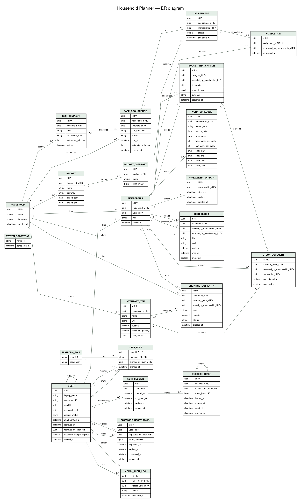

# ER-диаграмма базы данных

Концептуальная схема для MVP. `membership` связывает пользователя с домохозяйством: расписания, назначения и приватные интервалы недоступности относятся к конкретному членству. Причина недоступности в модели отсутствует. `app_user` хранит учётные данные и статус подтверждения, `auth_session`/`refresh_token` — отзывные сессии, а роли платформы и журнал аудита ограничивают и фиксируют действия администраторов.

Пользователь со статусом `PENDING` имеет доступ только к личному кабинету; `ACTIVE` открывает основные функции после подтверждения администратором.

В Mermaid сущность названа `USER`; в PostgreSQL она физически называется `app_user`, чтобы не использовать ключевое слово SQL.



[Открыть SVG для масштабирования](database-erd.svg)

```mermaid
erDiagram
    HOUSEHOLD ||--o{ MEMBERSHIP : has
    USER ||--o{ MEMBERSHIP : joins
    USER ||--o{ AUTH_SESSION : authenticates
    AUTH_SESSION ||--o{ REFRESH_TOKEN : rotates
    REFRESH_TOKEN o|--o| REFRESH_TOKEN : replaces
    USER ||--o{ USER_ROLE : receives
    PLATFORM_ROLE ||--o{ USER_ROLE : grants
    USER o|--o{ USER_ROLE : grants
    USER ||--o{ PASSWORD_RESET_TOKEN : resets
    USER o|--o{ PASSWORD_RESET_TOKEN : requests
    USER o|--o{ USER : approves
    USER ||--o{ ADMIN_AUDIT_LOG : acts
    USER ||--o{ ADMIN_AUDIT_LOG : targets
    MEMBERSHIP ||--o{ WORK_SCHEDULE : follows
    MEMBERSHIP ||--o{ AVAILABILITY_WINDOW : blocks
    HOUSEHOLD ||--o{ REST_BLOCK : plans
    MEMBERSHIP o|--o{ REST_BLOCK : reserves_for
    MEMBERSHIP ||--o{ REST_BLOCK : creates

    HOUSEHOLD ||--o{ TASK_TEMPLATE : defines
    TASK_TEMPLATE o|--o{ TASK_OCCURRENCE : generates
    HOUSEHOLD ||--o{ TASK_OCCURRENCE : schedules
    TASK_OCCURRENCE ||--o{ ASSIGNMENT : has
    MEMBERSHIP ||--o{ ASSIGNMENT : receives
    ASSIGNMENT ||--o| COMPLETION : completed_as
    MEMBERSHIP o|--o{ COMPLETION : completes

    HOUSEHOLD ||--o{ INVENTORY_ITEM : tracks
    INVENTORY_ITEM ||--o{ STOCK_MOVEMENT : changes
    MEMBERSHIP o|--o{ STOCK_MOVEMENT : records
    HOUSEHOLD ||--o{ SHOPPING_LIST_ENTRY : lists
    INVENTORY_ITEM o|--o{ SHOPPING_LIST_ENTRY : refers_to
    MEMBERSHIP o|--o{ SHOPPING_LIST_ENTRY : adds

    HOUSEHOLD ||--o{ BUDGET : owns
    BUDGET ||--o{ BUDGET_CATEGORY : groups
    BUDGET_CATEGORY ||--o{ BUDGET_TRANSACTION : categorizes
    MEMBERSHIP o|--o{ BUDGET_TRANSACTION : records
    BUDGET_TRANSACTION o|--o{ STOCK_MOVEMENT : pays_for

    SYSTEM_BOOTSTRAP {
        string name PK
        datetime completed_at
    }

    HOUSEHOLD {
        uuid id PK
        string name
        string timezone
        datetime created_at
    }

    USER {
        uuid id PK
        string display_name "user-editable nickname"
        string username UK "nullable for legacy accounts"
        string email UK
        string password_hash "nullable until password is enrolled"
        string account_status "PENDING, ACTIVE, SUSPENDED, REJECTED"
        datetime email_verified_at
        datetime approved_at
        uuid approved_by_user_id FK
        boolean password_change_required
        datetime created_at
    }

    PLATFORM_ROLE {
        string code PK "PLATFORM_ADMIN"
        string description
    }

    USER_ROLE {
        uuid user_id PK, FK
        string role_code PK, FK
        uuid granted_by_user_id FK
        datetime granted_at
    }

    AUTH_SESSION {
        uuid id PK
        uuid user_id FK
        datetime created_at
        datetime last_seen_at
        datetime expires_at
        datetime revoked_at
    }

    REFRESH_TOKEN {
        uuid id PK
        uuid session_id FK
        uuid replaced_by_token_id FK "nullable self-reference"
        bytes token_hash UK
        datetime issued_at
        datetime expires_at
        datetime used_at
        datetime revoked_at
    }

    PASSWORD_RESET_TOKEN {
        uuid id PK
        uuid user_id FK
        uuid requested_by_user_id FK "null means self-service"
        bytes token_hash UK
        datetime requested_at
        datetime expires_at
        datetime consumed_at
        datetime revoked_at
    }

    ADMIN_AUDIT_LOG {
        uuid id PK
        uuid actor_user_id FK
        uuid target_user_id FK
        string action
        datetime occurred_at
    }

    MEMBERSHIP {
        uuid id PK
        uuid household_id FK
        uuid user_id FK
        string role
        datetime joined_at
    }

    WORK_SCHEDULE {
        uuid id PK
        uuid membership_id FK
        string pattern_type "WEEK_5_2 or CYCLE_2_2"
        date anchor_date "required for CYCLE_2_2"
        json work_days "for WEEK_5_2"
        int work_days_per_cycle "2 for CYCLE_2_2"
        int rest_days_per_cycle "2 for CYCLE_2_2"
        time shift_start
        time shift_end
        date valid_from
        date valid_until
    }

    AVAILABILITY_WINDOW {
        uuid id PK
        uuid membership_id FK
        datetime starts_at
        datetime ends_at
        datetime created_at
    }

    REST_BLOCK {
        uuid id PK
        uuid household_id FK
        uuid created_by_membership_id FK
        uuid reserved_for_membership_id FK "null means household-wide"
        string title
        string kind "PERSONAL, SHARED, VACATION"
        datetime starts_at
        datetime ends_at
        boolean protected
    }

    TASK_TEMPLATE {
        uuid id PK
        uuid household_id FK
        string title
        string recurrence_rule
        int estimated_minutes
        boolean active
    }

    TASK_OCCURRENCE {
        uuid id PK
        uuid household_id FK
        uuid template_id FK "nullable for one-off task"
        string title_snapshot
        string status
        datetime due_at
        int estimated_minutes
        datetime created_at
    }

    ASSIGNMENT {
        uuid id PK
        uuid occurrence_id FK
        uuid membership_id FK
        string status
        datetime assigned_at
    }

    COMPLETION {
        uuid id PK
        uuid assignment_id FK UK
        uuid completed_by_membership_id FK
        datetime completed_at
    }

    INVENTORY_ITEM {
        uuid id PK
        uuid household_id FK
        string name
        string unit
        decimal quantity
        decimal minimum_quantity
        date best_before
    }

    STOCK_MOVEMENT {
        uuid id PK
        uuid inventory_item_id FK
        uuid recorded_by_membership_id FK
        uuid transaction_id FK "nullable"
        decimal quantity_delta
        datetime occurred_at
    }

    SHOPPING_LIST_ENTRY {
        uuid id PK
        uuid household_id FK
        uuid inventory_item_id FK "nullable for free text"
        uuid added_by_membership_id FK
        string label
        decimal quantity
        string status
        datetime created_at
    }

    BUDGET {
        uuid id PK
        uuid household_id FK
        string name
        string currency
        date period_start
        date period_end
    }

    BUDGET_CATEGORY {
        uuid id PK
        uuid budget_id FK
        string name
        bigint limit_minor
    }

    BUDGET_TRANSACTION {
        uuid id PK
        uuid category_id FK
        uuid recorded_by_membership_id FK
        string description
        bigint amount_minor
        string currency
        datetime occurred_at
    }
```

## Ограничения и инварианты

- `WEEK_5_2` использует выбранные рабочие дни и время смены. `CYCLE_2_2` рассчитывает рабочие/выходные дни от `anchor_date`; смена может пересекать полночь.
- `AVAILABILITY_WINDOW` хранит только границы периода. Причина не запрашивается, не хранится и не показывается.
- Планировщик не назначает дела в рабочие смены и защищённые `REST_BLOCK`; ручное переопределение должно быть явным действием участника.
- Количество запаса меняется только через `STOCK_MOVEMENT`. Покупка может связать одну бюджетную транзакцию с несколькими движениями запасов.
- Денежные суммы хранятся целым числом в минимальных единицах валюты, не `float`/`double`.
- Уникальные ограничения: `MEMBERSHIP(household_id, user_id)`; для одного бюджета не должно быть дублирующих категорий с одинаковым именем.
- Все чтения и записи проверяют членство и ограничиваются `household_id`.
- Access JWT не хранится в БД; refresh-токены хранятся только в виде криптографического хеша, каждый выпущенный при ротации refresh-токен сохраняется для выявления повторного использования.
- Роль администратора платформы хранится отдельно от роли владельца/участника домохозяйства. Подтверждение аккаунта и изменение его статуса фиксируются в `admin_audit_log`.
- Сброс пароля использует одноразовый случайный токен с ограниченным сроком действия; хранится только его хеш. Администратор запускает доставку ссылки, но не задаёт и не видит новый пароль.


## Инварианты модуля аккаунтов

- `system_bootstrap` — одноразовый маркер создания первого администратора; пароль `admin/admin` не восстанавливается после перезапуска.
- `password_change_required` ограничивает доступ до смены временного пароля; `PENDING` разрешает только личный кабинет.
- Подтверждение администратором переводит `PENDING` в `ACTIVE`. Поле `email_verified_at` зарезервировано для будущей проверки владения email и пока не является условием доступа.
- В цепочке refresh-токенов только одна неиспользованная/неотозванная запись на сессию. Составной FK проверяет, что replacement принадлежит той же сессии.
- Восстановление пароля не меняет статус аккаунта. Погашение токена, изменение хеша и отзыв сессий выполняются транзакционно.
- `approved_by_user_id` может стать null после удаления администратора, при этом историческая дата подтверждения сохраняется.
